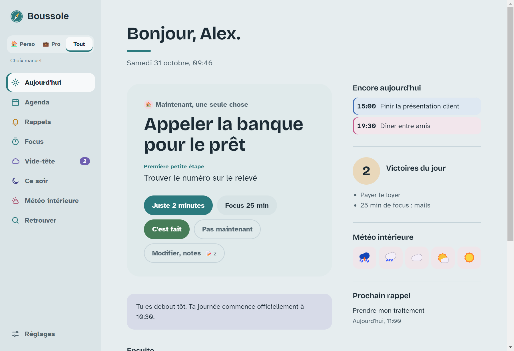
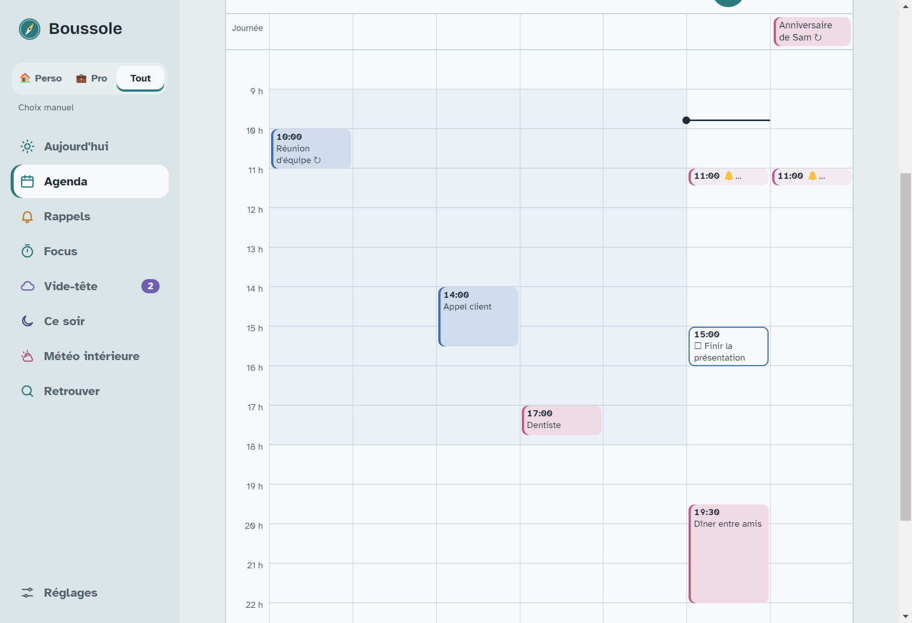
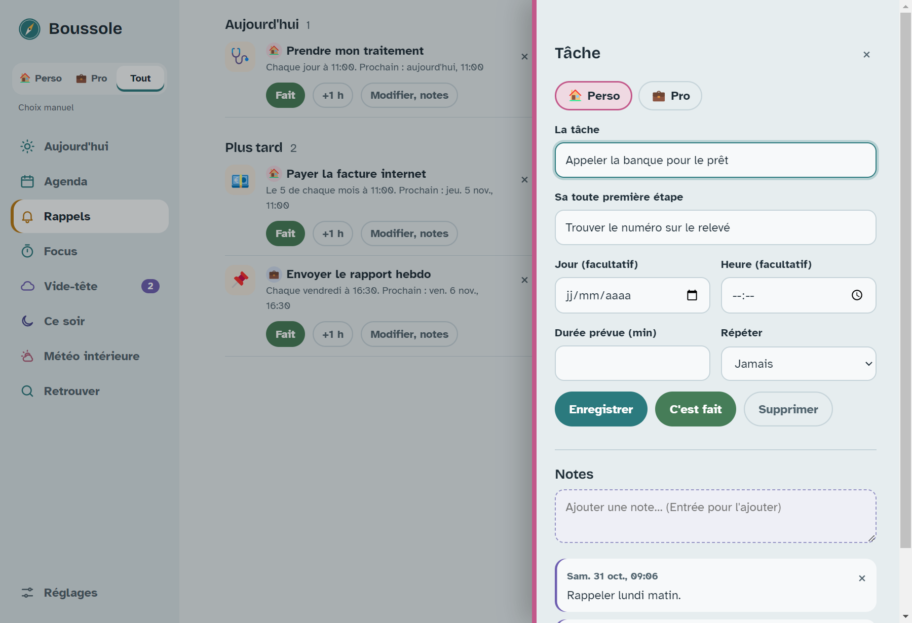
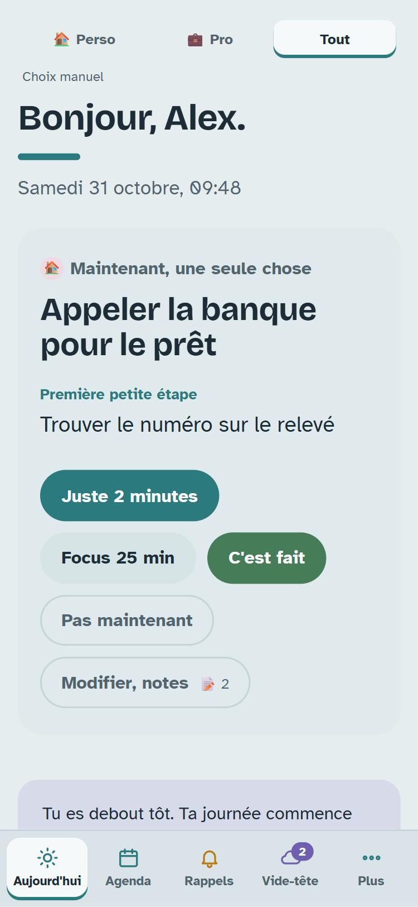
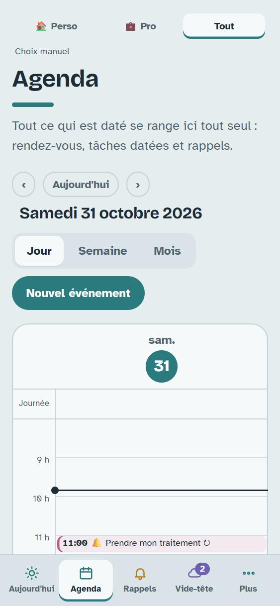
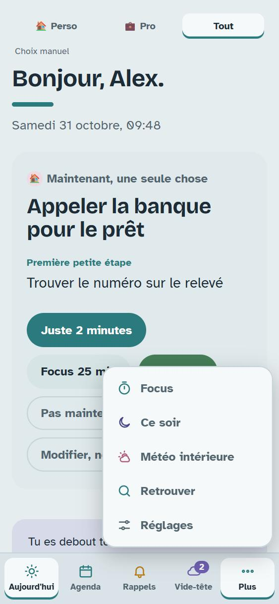
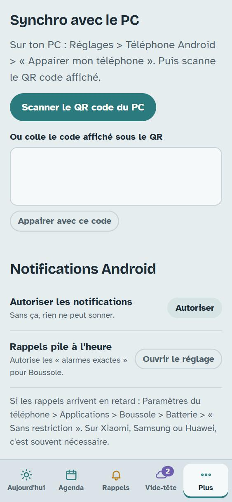
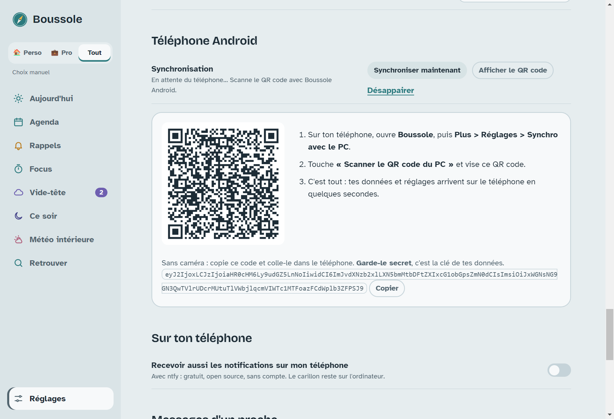

# 🧭 Boussole

**Une appli pour s'orienter quand on a un TDAH** : ne plus oublier, réussir à démarrer, voir le temps passer,
séparer le perso du pro et fermer la journée en douceur. Sur **Windows** et **Android**, synchronisée entre les deux.

Gratuite, open source (licence MIT). Tes données restent **chez toi** : rien n'est envoyé à une entreprise.

> 🤖 **Créée avec une IA.** Boussole a été conçue et programmée par **Claude Opus 5.5** (le modèle d'IA d'Anthropic),
> réglé en **effort de réflexion élevé**, dans Claude Code. Son auteur, [kori-tmathey](https://github.com/kori-tmathey),
> a décrit ses besoins (à partir de son propre profil TDAH), puis guidé, testé et validé chaque étape.



---

## Sommaire

1. [Ce que fait Boussole](#-ce-que-fait-boussole)
2. [Installer sur Windows](#-installer-sur-windows)
3. [Installer sur Android](#-installer-sur-android)
4. [Relier le téléphone et le PC](#-relier-le-téléphone-et-le-pc-synchronisation)
5. [Comment marche la synchronisation](#-comment-marche-la-synchronisation)
6. [Options : notifications ntfy et messages d'un proche](#-options--notifications-ntfy-et-messages-dun-proche)
7. [Ce qui ne marche pas (limites connues)](#%EF%B8%8F-ce-qui-ne-marche-pas-limites-connues)
8. [Vie privée](#-vie-privée)
9. [Pour les développeurs](#-pour-les-développeurs)

---

## ✨ Ce que fait Boussole

| | |
|---|---|
| **Aujourd'hui** | Une seule tâche à la fois, avec sa toute première petite étape, un bouton « Juste 2 minutes » et un rail qui montre le temps restant avant le coucher. |
| **Agenda** | Vue jour, semaine ou mois. Se remplit tout seul (rendez-vous, tâches datées, rappels). Glisser-déposer. Récurrences : chaque jour, semaine, mois, année (anniversaires). |
| **Une chose à la fois** | Impossible de placer deux choses sur le même créneau (perso ou pro) : un message explique ce qui est déjà prévu. |
| **Rappels insistants** | Ils reviennent toutes les X minutes jusqu'à « Fait », sans reproche. Option « urgent ». |
| **Perso / Pro** | Couleurs, filtres, sons et notifications séparés. Le pro attend le soir et le week-end, le perso se fait discret pendant le travail. |
| **Focus** | Un disque qui se vide pour *voir* le temps, plus un carillon régulier pour le sentir passer. |
| **Vide-tête** | Noter une pensée en 2 secondes (`Ctrl+Maj+Espace` partout dans Windows). Parking à idées sans culpabilité. |
| **Ce soir** | Décrocher, voir ses victoires du jour, respirer (cohérence cardiaque), aller dormir. |
| **Météo intérieure** | Humeur, énergie et tension en un clic, historique sur 30 jours et résumé à montrer à son médecin. |
| **Fiches et notes** | Tout se modifie, et chaque élément a un fil de notes datées. Recherche dans tout, archive de ce qui est terminé. |
| **Personnalisable** | 7 thèmes pensés avec la psychologie des couleurs (dont un thème du soir sans lumière bleue), ton des messages, horaires, modules… |

<p align="center">
  
  
</p>
<p align="center">
  
  
  
  
</p>

---

## 💻 Installer sur Windows

*Testé sur Windows 11. Il faut Windows 10 ou 11, 64 bits.*

1. Va dans les [**Releases**](../../releases/latest) et télécharge **`Boussole-Setup-x.y.z.exe`** (le plus récent).
2. Lance le fichier téléchargé.
3. Windows affiche sans doute un écran bleu **« Windows a protégé votre ordinateur »**.
   C'est normal : l'installateur n'est pas « signé » (une signature coûte de l'argent).
   Clique sur **Informations complémentaires**, puis sur **Exécuter quand même**.
4. Choisis **« Pour moi uniquement »**, garde le dossier proposé, clique sur **Installer**, puis **Terminer**.
5. Boussole s'ouvre. Un raccourci est créé sur le Bureau et dans le menu Démarrer.

**Bon à savoir**
- **Fermer la fenêtre ne quitte pas Boussole** : elle reste près de l'horloge (en bas à droite) pour que les rappels sonnent.
  Pour la quitter vraiment : clic droit sur l'icône près de l'horloge, puis **Quitter**.
- Elle **démarre avec Windows**, discrètement (désactivable dans Réglages > Windows).
- **Mises à jour automatiques** : elles se téléchargent seules et s'installent quand Boussole se ferme.
  Pour forcer : Réglages > Mises à jour > **Vérifier maintenant**, puis **Redémarrer et mettre à jour**.
- Tes données sont dans `%AppData%\Boussole` (une sauvegarde par jour sur 7 jours, plus une copie possible vers ton cloud).

---

## 📱 Installer sur Android

*Android 7 ou plus récent. Il n'existe pas de version iPhone.*

### Méthode conseillée : avec Obtainium (mises à jour automatiques)

[Obtainium](https://github.com/ImranR98/Obtainium) est une appli gratuite et open source qui installe des applis
directement depuis GitHub et prévient des nouvelles versions.

1. Installe **Obtainium** : depuis [F-Droid](https://f-droid.org/packages/dev.imranr.obtainium.fdroid/),
   [IzzyOnDroid](https://apt.izzysoft.de/fdroid/index/apk/dev.imranr.obtainium) ou ses
   [releases GitHub](https://github.com/ImranR98/Obtainium/releases) (fichier `.apk`).
2. Ouvre Obtainium, touche **Ajouter une appli** (Add App).
3. Dans « URL de la source », colle : **`https://github.com/kori-tmathey/boussole`** puis touche **Ajouter**.
4. Touche **Installer**. Android demande d'autoriser Obtainium à **installer des applis inconnues** :
   touche **Paramètres**, active l'autorisation, puis reviens et confirme l'installation.
5. Pour les prochaines versions : Obtainium affiche une mise à jour, tu touches **Mettre à jour**.

### Autre méthode : télécharger l'APK à la main

Dans les [**Releases**](../../releases/latest), télécharge **`Boussole-x.y.z.apk`** depuis ton téléphone,
ouvre-le et autorise l'installation quand Android le demande. Tu devras refaire ça à chaque nouvelle version.

### Au premier lancement (important pour que les rappels sonnent)

1. Accepte quand Boussole demande à **envoyer des notifications**.
2. Va dans **Plus > Réglages > Notifications Android** et touche **Ouvrir le réglage** à côté de
   « Rappels pile à l'heure » : active **Alarmes et rappels** pour Boussole.
3. Sur **Xiaomi, Samsung, Huawei, Oppo…** : Paramètres du téléphone > Applications > Boussole > **Batterie** >
   **Sans restriction**. Sinon le téléphone peut retarder ou bloquer les rappels.

---

## 🔗 Relier le téléphone et le PC (synchronisation)

Il faut avoir installé Boussole sur les deux, **en version 1.3.0 ou plus**.

1. **Sur le PC** : Réglages > **Téléphone Android** > **Appairer mon téléphone**. Un QR code s'affiche.

   

2. **Sur le téléphone** : **Plus > Réglages > Synchro avec le PC** > **Scanner le QR code du PC**.
   Autorise la caméra et vise le QR code.
   *Sans caméra* : sur le PC, clique sur **Copier** sous le QR code, envoie-toi ce code
   (par exemple dans une messagerie), puis colle-le dans « Ou colle le code » et touche **Appairer avec ce code**.

   

3. C'est tout. En quelques secondes, le téléphone reçoit toutes tes tâches, rappels, événements, notes **et tes réglages**
   (sphères, horaires, messages d'un proche…). Au premier appairage, **le téléphone adopte les réglages du PC**.

⚠️ **Garde le QR code et le code secrets** : ils contiennent la clé qui protège tes données.
Si tu penses qu'ils ont été vus : **Désappairer** des deux côtés, puis recommencer (une nouvelle clé est créée).

---

## 🔄 Comment marche la synchronisation

**En résumé : chaque appareil garde sa propre copie complète. Ils s'échangent les changements dès qu'ils sont allumés
en même temps. Rien ne se perd, même si l'un des deux reste éteint longtemps.**

### Ce qui est synchronisé
- ✅ Tâches, rappels, événements, idées, notes, météo intérieure, victoires, heures de coucher.
- ✅ Les réglages communs : prénom, ton, sphères, horaires de travail, thèmes, modules, agenda, messages d'un proche…
- ❌ Ce qui est propre à un appareil : raccourci clavier, démarrage avec Windows, taille du texte, copie vers le cloud.

### Quand ça se synchronise
- Quelques secondes après chaque modification, l'appareil envoie son état.
- Le **PC** regarde s'il y a du nouveau **toutes les 15 secondes** (tant que Boussole tourne, même réduite près de l'horloge).
- Le **téléphone** regarde **à l'ouverture de Boussole**, puis **toutes les 20 secondes tant qu'elle est ouverte**.
  Android met les applis en pause en arrière-plan : **ouvre Boussole sur le téléphone** pour qu'il se mette à jour.
- Bouton **Synchroniser maintenant** dans les Réglages des deux côtés.

### Et si un appareil est éteint ?

| Situation | Ce qui se passe |
|---|---|
| **PC éteint**, téléphone utilisé | Tout marche sur le téléphone : tâches, agenda, et **les rappels sonnent** (ils sont programmés dans le téléphone). Tes changements partent tout de suite ; le PC les récupère au rallumage s'il revient dans les ~3 heures. Au-delà, il les récupère dès que tu ouvres Boussole sur le téléphone pendant que le PC est allumé. |
| **Téléphone éteint**, PC utilisé | Tout marche sur le PC. Le téléphone rattrape tout quand tu le rallumes et **ouvres Boussole** pendant que le PC est allumé. |
| **Les deux éteints à des moments différents** | Chacun garde ses changements. Ils fusionnent la prochaine fois que les deux sont allumés en même temps (PC allumé + Boussole ouverte sur le téléphone). |
| **Pas d'internet** | Chaque appareil fonctionne seul. La synchro reprend quand internet revient. |

### Si la même chose est modifiée des deux côtés
- **La modification la plus récente gagne**, élément par élément (une tâche entière, un rappel entier…).
  Si tu changes le titre d'une tâche sur le PC puis sa date sur le téléphone avant que les deux se soient parlé,
  c'est la dernière version (celle du téléphone) qui est gardée.
- **Supprimer** une chose d'un côté la supprime de l'autre, sauf si elle a été modifiée de l'autre côté *après* la suppression.
- Les horloges des deux appareils doivent être **à l'heure** (réglage automatique de l'heure activé).

### Notifications une fois appairé
- Les rappels **sonnent sur le téléphone ET sur le PC** (chacun programme les siens).
- Le PC **arrête** d'envoyer ses notifications par ntfy vers le téléphone (inutile, l'appli Android sonne elle-même) :
  tu peux te désabonner de ce sujet dans l'appli ntfy si tu l'utilisais.

### Sécurité
- Les échanges passent par [ntfy.sh](https://ntfy.sh), un service gratuit et open source de messages.
- Tout est **chiffré de bout en bout** (AES-256-GCM) avec une clé créée sur ton PC et transmise **uniquement** par le QR code.
  ntfy ne voit qu'un texte illisible, plus l'heure et la taille des envois.
- ntfy.sh garde les messages environ **12 heures** et les données échangées environ **3 heures**, puis les efface.

---

## 🔔 Options : notifications ntfy et messages d'un proche

Ces deux options utilisent l'appli gratuite **ntfy** (Android, iPhone, ou un simple navigateur). Elles marchent même sans l'appli Android de Boussole.

### Recevoir les notifications du PC sur un téléphone (même un iPhone)
Réglages > **Sur ton téléphone** > active l'option, puis dans l'appli ntfy : **+** > abonne-toi au sujet affiché.
Le PC doit être allumé pour envoyer. Inutile si tu utilises déjà Boussole Android appairée.

### Laisser un proche t'envoyer des tâches et des rappels
Réglages > **Messages d'un proche** > active, indique son prénom, puis **Copier le message** et envoie-le-lui.
Il ou elle écrit simplement, depuis l'appli ntfy ou le lien dans un navigateur :
- `Acheter du pain` → une tâche
- `Dentiste lundi à 17h30` → une tâche datée
- `rappel Appeler le garage demain 10h` → un rappel
- `rappel Anniversaire de maman le 12/11` → un rappel ce jour-là

Boussole répond « ✓ Reçu » quand c'est arrivé. Les messages sont gardés **12 heures** par ntfy :
si aucun de tes appareils n'est allumé (PC) ou ouvert (téléphone) dans ce délai, le message est perdu (pas de « ✓ Reçu »).

---

## ⚠️ Ce qui ne marche pas (limites connues)

Pour être honnête et éviter les mauvaises surprises :

- **Pas de version iPhone, Mac ou Linux.** Seulement Windows (10/11, 64 bits) et Android (7+).
- **Installateur Windows non signé** : avertissement « Windows a protégé votre ordinateur » à l'installation.
- **Android en arrière-plan** : la synchro et la lecture des messages d'un proche se font **seulement quand l'appli est ouverte**.
  Les rappels, eux, sonnent toujours (ils sont programmés à l'avance).
- **Rappels programmés 7 jours à l'avance sur Android** (60 maximum) : ouvre Boussole sur le téléphone au moins une fois par semaine pour que la suite soit programmée.
- **Économie de batterie** : certains téléphones (Xiaomi, Samsung, Huawei…) retardent ou bloquent les rappels si Boussole n'est pas en « Batterie : sans restriction ».
- **Synchro : il faut que les deux appareils soient allumés à un moment en même temps** pour échanger (PC allumé + Boussole ouverte sur le téléphone). Sans ça, chacun garde ses données de son côté (rien n'est perdu).
- **Conflits** : si la même tâche est modifiée des deux côtés avant synchro, la version la plus récente remplace l'autre en entier (pas de fusion champ par champ).
- **Dépend de ntfy.sh** (gratuit) pour la synchro, les notifications ntfy et les messages d'un proche. S'il est en panne, ça attend. Tu peux utiliser ton propre serveur ntfy (Réglages > Sur ton téléphone > Serveur ntfy, avant l'appairage).
- **Un seul téléphone** a été prévu et testé par appareil PC. Plusieurs appareils devraient fonctionner mais ce n'est pas testé.
- **Pas de travail à plusieurs** : un proche peut t'*envoyer* des tâches, mais ne voit pas ton agenda.
- **Seulement sur PC** : raccourci clavier du vide-tête, import/export de fichiers, copie vers le cloud.
- **Si tu désinstalles Boussole Android sans l'avoir appairée**, ses données sont perdues (appairée, le PC en a une copie).
- **Version Android récente** : elle a été testée sur un banc d'essai qui simule Android, les retours sur de vrais téléphones sont les bienvenus ([ouvrir un ticket](../../issues)).
- **Ce n'est pas un dispositif médical.** Le résumé « pour ton médecin » aide à en parler, il ne remplace pas un avis médical.

---

## 🔒 Vie privée

- Sur PC, tout est dans `%AppData%\Boussole` ; sur Android, dans la mémoire privée de l'appli.
- Aucun compte, aucune publicité, aucune statistique d'utilisation.
- Rien ne sort de tes appareils **sauf** si tu actives toi-même : la synchro (chiffrée), les notifications ntfy,
  les messages d'un proche (le texte passe par ntfy) ou la copie vers ton cloud.

---

## 🛠️ Pour les développeurs

```bash
npm install
npm start       # lancer l'appli PC (Electron)
npm test        # tests de la logique : rappels, récurrences, agenda, notifications, synchro, chiffrement…
npm run dist    # fabriquer l'installateur Windows
npm run mobile  # préparer l'appli Android (Capacitor) ; puis : cd android && gradlew assembleRelease
```

- Même interface pour les deux (`renderer/`), avec deux « ponts » : `preload.js` (Electron) et `renderer/mobile-api.js` (Capacitor).
- Logique pure et testée dans `logic.js`, synchro dans `sync.js`.
- Fonctionnement détaillé : [docs/spec.md](docs/spec.md) et [docs/superpowers/specs](docs/superpowers/specs).
- Pour essayer sans toucher à tes données : `BOUSSOLE_DATA=<dossier> npm start`.

## Licence

[MIT](LICENSE) : libre de l'utiliser, la modifier et la partager.
